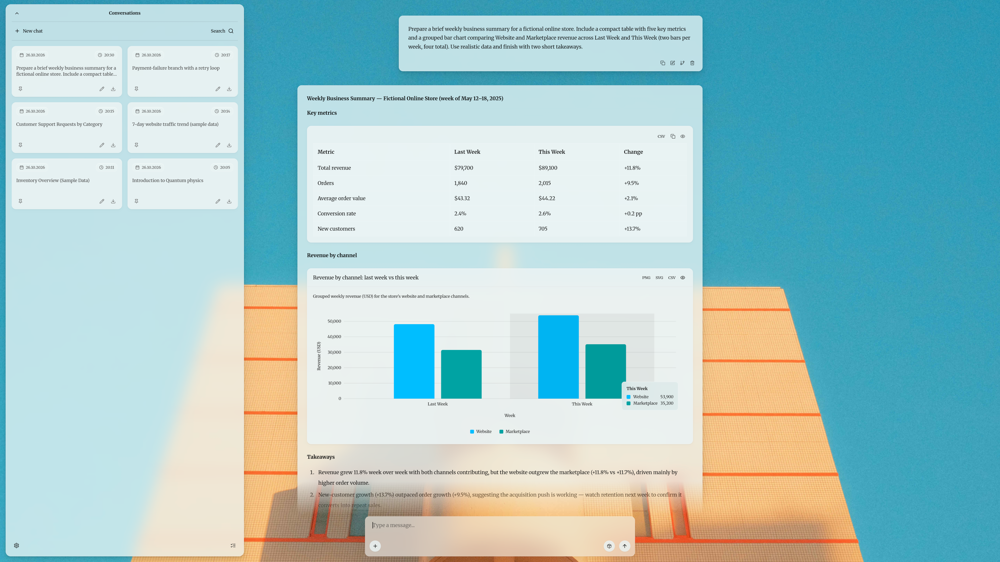
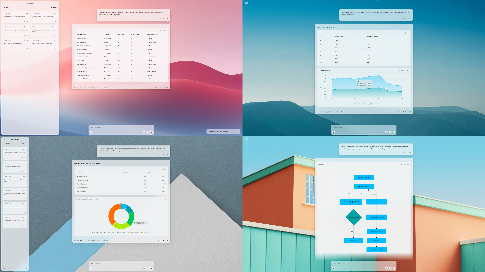
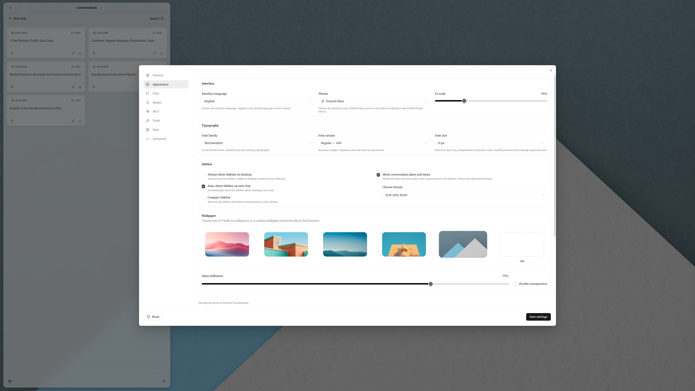

# llampart

**Chat with your AI models in an interface you can make your own.**

llampart is an open-source chat interface designed to work with **llama-server, vLLM, and OpenAI-compatible API servers**.

It combines a customizable **Frosted Glass interface** with advanced conversation management, model-aware controls, reasoning and tool workflows, rich Markdown rendering, interactive charts, and Mermaid diagrams.

Built with SvelteKit and Svelte 5, llampart runs as a lightweight web application while keeping conversations and most application settings locally in your browser.

The model backend runs separately, giving you control over where and how your AI models are served.

## Screenshots

### Main chat experience



### Rich content and visualizations



### Appearance & Personalization



## Features

### Frosted Glass & Personalization

A distinctive, customizable interface built around the Frosted Glass visual theme.

- Five built-in wallpapers and support for custom local wallpapers.
- Wallpaper-aware color accents, translucent surfaces, blur effects, and adjustable glass milkiness.
- An option to disable transparency for more opaque interface surfaces.
- Bundled offline fonts, font variants, and adjustable text sizes.
- Independent interface scaling and customizable sidebar layout.
- Six interface languages: English, Polish, German, French, Italian, and Spanish.

### Models & Providers

Connect to different AI model servers through a provider-aware architecture.

- **llama-server** — native integration with supported llama.cpp server capabilities.
- **vLLM** — dedicated provider support with model-aware capabilities and usage information.
- **OpenAI-compatible** — connectivity to servers implementing supported OpenAI API endpoints.
- Support for Chat Completions and Responses workflows where available.
- Model selection, connection management, and provider-specific controls.
- Model-aware reasoning settings and supported generation parameters.

Available capabilities depend on the connected server, model, and API implementation.

### Conversations & Local Data

Manage conversations locally with tools designed for longer, more complex interactions.

- Conversation history stored in the browser using IndexedDB.
- Branching conversations, message editing, and response regeneration.
- Pinned conversations and a configurable tiled conversation sidebar.
- Conversation search, selection, and management.
- Import and export of conversation history.
- Local persistence of user preferences and application settings.

### Rich Markdown & Visualizations

llampart goes beyond plain text responses with interactive content rendered directly in the conversation.

- Markdown formatting, tables, syntax-highlighted code, and mathematical expressions.
- Copyable tables with CSV export and expanded table previews.
- Code blocks with dedicated typography, syntax highlighting, copying, and file downloads.
- **Interactive charts:** Line, Area, Bar, and Donut.
- **Mermaid diagrams:** Flowchart, State, Mindmap, and Gantt.
- Expanded previews and export options for supported visualizations, including PNG, SVG, and CSV where applicable.
- Markdown downloads for assistant responses.

Visualizations are rendered locally in the browser. Their availability and correctness depend on the content generated by the model.

### Reasoning, Tools & MCP

Advanced interaction features for supported models and connected tools.

- Reasoning display and model-dependent reasoning controls.
- Tool calling and agentic workflows.
- Model Context Protocol (MCP) integration.
- MCP tools, prompts, and resources.
- Configurable presentation of reasoning and tool activity.
- Response preferences for formatting, conciseness, examples, tables, charts, diagrams, and other response characteristics.
- Custom system instructions and advanced generation settings.

Tool execution and advanced model features depend on backend capabilities and the configured integrations.

### How llampart works

llampart is designed as a browser-based frontend rather than a hosted AI service.

- Conversations and most application preferences are stored locally.
- Model inference is handled by your separately configured backend.
- No llampart cloud account or hosted llampart service is required.
- The static Web UI can be served through an existing Caddy installation.

Requests and data may be sent to the model servers and external tools you choose to configure. llampart does not make a remote backend local simply by connecting to it.

## Installation

llampart provides a Linux installer that deploys prebuilt release assets and configures an existing Caddy installation to serve the Web UI.

The installer supports Ubuntu-based and Arch Linux-based distributions using systemd.

```bash
curl -fsSL https://raw.githubusercontent.com/mchowy-troll/llampart/main/install.sh | bash
```

The installer supports installation, updating, reconfiguration, and uninstallation.

It manages the llampart Web UI deployment and its Caddy configuration. It does **not** install Caddy itself, AI models, model inference servers, Node.js, or development dependencies.

For detailed instructions, available options, and troubleshooting, see the [Linux installation guide](docs/installation/linux-caddy.md).

## Requirements

### Installed Web UI

- A supported Linux distribution with systemd when using the bundled installer.
- An existing Caddy 2.11.4 or newer installation, available as a systemd service.
- The `ss` command from `iproute2` for the installer's port availability check.
- A separately running AI backend supported by llampart.
- A modern browser with the required browser storage and JavaScript capabilities.

llampart is primarily designed for desktop use.

### Development

- Node.js `>=22.13.0 <23` or `>=24.0.0`
- npm
- Git

## Development

Clone the repository and install the Web UI dependencies.

```bash
git clone --depth 1 https://github.com/mchowy-troll/llampart.git
cd llampart/server/webui
npm ci
npm run dev
```

The shallow clone includes the current sources and all five bundled wallpapers, without the repository history. A local build is recommended; use a regular clone without `--depth 1` if you need the full history.

Common validation commands:

```bash
npm run lint
npm run check
npm test
npm run build
```

The frontend uses Svelte 5, SvelteKit, Vite, and TypeScript.

Production builds generate the static Web UI in `server/public`.

### Release packaging

Release archives are prepared from a validated production build using:

```bash
bash scripts/package-release-llampart.sh
```

The release workflow includes build provenance checks and integrity verification. Packaging requires a matching clean build and Git state.

Official releases and downloadable assets are published through [GitHub Releases](https://github.com/mchowy-troll/llampart/releases).

## Documentation

- [Linux installation and configuration](docs/installation/linux-caddy.md)
- [Third-party licenses and notices](THIRD_PARTY_LICENSES.md)
- [Project attribution](NOTICE)
- [Contributors and asset credits](AUTHORS.md)

## Project Origins & Credits

llampart is developed and maintained by **Marcin Gluziński**.

The project builds upon and adapts work from [llama.cpp](https://github.com/ggml-org/llama.cpp), including its original llama-ui foundation.

Special thanks to the **ggml-org maintainers and contributors** for their open-source work.

llampart also benefits from the broader open-source ecosystem, including Svelte, SvelteKit, Mermaid, and the libraries used for Markdown processing, visualization, and browser-based functionality.

Thanks to the maintainers and contributors of these projects for making their work available to the community.

Third-party software, fonts, and bundled visual assets retain their applicable licenses and attribution requirements. See `AUTHORS.md`, `NOTICE`, and `THIRD_PARTY_LICENSES.md` for detailed information.

llampart is an independent project and is not an official llama.cpp, vLLM, or OpenAI product.

## License

llampart is released under the **MIT License**.

See [LICENSE](LICENSE) for the full license text.

Third-party notices and license information are provided in [NOTICE](NOTICE) and [THIRD_PARTY_LICENSES.md](THIRD_PARTY_LICENSES.md).
