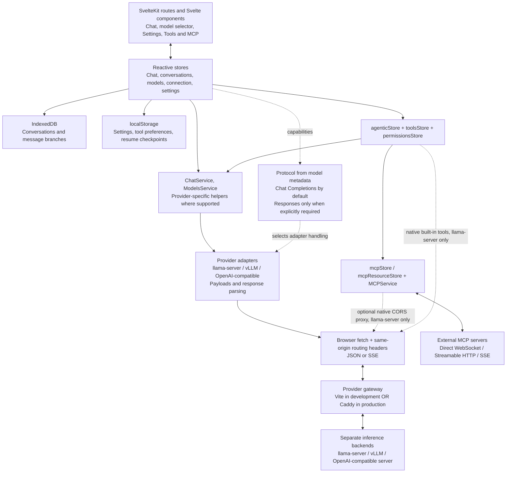

# Simplified architecture

The application runs in the browser; inference runs separately. The gateway is
development middleware in Vite **or**, in the installed production setup, Caddy —
not another application service.

- `DatabaseService` owns IndexedDB access. Settings and tool preferences use existing
  browser storage; the gateway does not store conversation history.
- Tools/agentic orchestration and direct MCP are shared. Native props/defaults,
  router load/unload, built-in `/tools`, pre-encode and resumable V2 are llama-server-only.
- Model capabilities can be supported, unsupported or unknown. Protocol selection
  is metadata-driven, not a generation probe or retry/fallback mechanism.
- Charts and the four allowed Mermaid families render locally in assistant answers.
  Technical documentation can use other Mermaid syntax, such as sequence diagrams;
  that does not expand the application's [rendering allowlist](../diagrams.md).

See the [detailed architecture](high-level-architecture.md),
[chat flow](../flows/chat-flow.md) and [development guide](../../README.md).
