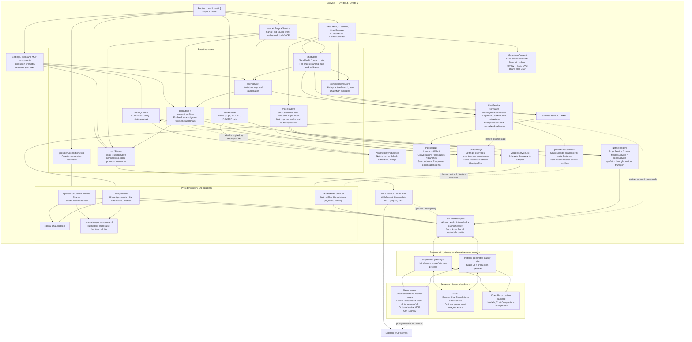

# Detailed architecture

This diagram groups actual modules by responsibility rather than listing every
store method. See the [simplified view](high-level-architecture-simplified.md)
for the main runtime boundaries.

## Provider and protocol boundaries

- `ApiProviderAdapter` owns connection validation, model discovery, payload building
  and response/stream parsing. Despite the historical `buildChatCompletionRequest`
  name, the vLLM/OpenAI-compatible adapters can build **Responses** requests too.
- `modelsStore.refreshCapabilities()` uses model-list metadata already fetched for
  the current source; it is not an extra inference probe. Static adapter support
  and runtime model evidence are separate. Missing metadata stays **unknown**.
- llama-server always uses Chat Completions. Compatible providers prefer it when
  both protocols are declared, default to it without evidence, and use Responses
  only for an explicit requirement. There is no automatic POST retry/fallback.
  See [models and capability selection](../flows/models-flow.md).
- `ChatService` consumes normalized provider events. Native prompt progress/timings
  are not universal SSE fields; other providers expose usage/outcomes when supplied.
  vLLM client speed estimates are distinct from backend timings. The diagnostic
  `readVllmTelemetry()` helper is not a UI polling service or chat-turn metric source.

## Transport and persistence

All provider HTTP requests go through `/__llampart/api/{provider}/{endpoint}`.
The Vite middleware and installed Caddy validate routing metadata and allowlisted
endpoint/method pairs, strip routing headers/cookies, and stream upstream responses.
Cancellation closes the upstream request. These are trusted-LAN gateways, not
authentication services or destination/DNS/IP firewalls. `vite preview` does not
install the dev middleware. See the [frontend guide](../../README.md) and
[production gateway contract](../../../../docs/installation/linux-caddy.md).

Conversation/message branches and stream checkpoints are persisted through
`DatabaseService`. Native resumable identity/byte offsets additionally use localStorage.
Responses continuation items stay in local IndexedDB and are bound to source, credential
fingerprint, protocol and model; they are not a backend-stored conversation.
Rendering charts/diagrams does not add storage tables or a rendering service.

## Tools, MCP and native-only helpers

The agentic loop uses enabled, uniquely resolved entries from `toolsStore`, checks
permissions, executes tools and appends results before the next `ChatService` call.
Direct MCP connections work independently of the inference provider. Only llama-server
provides native built-in `/tools` and optional `/cors-proxy`; proxied MCP requests
use the frozen native address/key, separately from target MCP authentication headers.

Props/default synchronization, MODEL/ROUTER role detection, model load/unload,
chat-template inspection, slots/pre-encode, prompt progress and resumable V2 remain
native integrations. See [chat](../flows/chat-flow.md), [models](../flows/models-flow.md),
[server](../flows/server-flow.md) and [MCP](../flows/mcp-flow.md).
