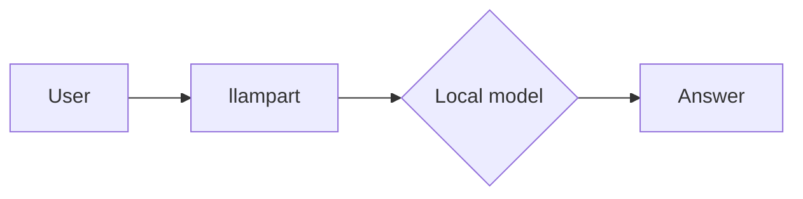
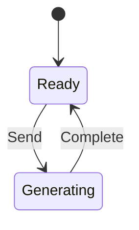
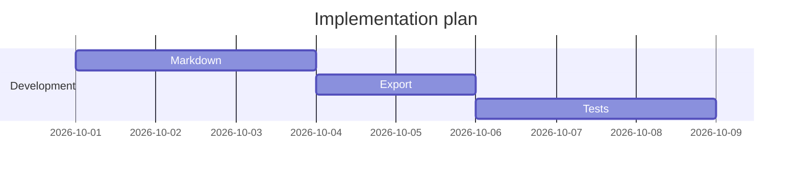
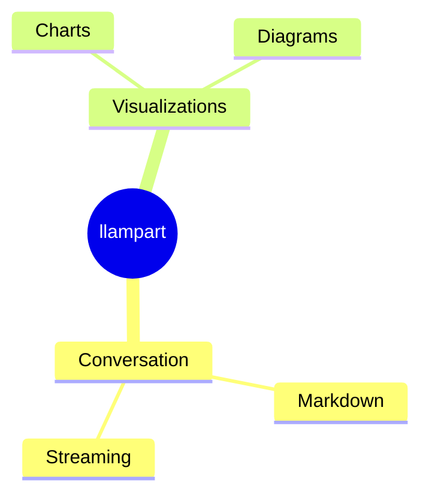

# Local Mermaid diagrams

llampart 1.9.0 renders four Mermaid diagram families in assistant answer sections.
The source stays in the original Markdown message; SVG is presentation only.
There is no extra database table, migration, MCP server or rendering service.
User messages, reasoning and raw tool results remain ordinary code blocks.
Statistical charts remain separate: `llampart-chart` supports line, area, bar and
donut, unchanged. Mermaid Pie and XYChart are not enabled.

## Supported syntax examples

Use a closed fenced block with the language `mermaid`. Both backtick and tilde
fences are supported. Mermaid 12.2.0 parses syntax and computes geometry.

### Flowchart (`graph` is also accepted)



### State



### Gantt



### Mindmap



## Model instructions and preferences

The ninth Response Preferences checkbox, **Use diagrams**, defaults to off and
sits immediately after **Use charts** in Formatting and visualizations. It is
independent of charts. Save, Cancel, Reset, settings import/export and the English
instruction preview use the existing transactional settings mechanism.

The checkbox controls when the model must include a meaningful diagram. A short
technical format instruction is always available, including when it is off:
users can ask directly for a diagram. Models must use correct fenced Mermaid,
only these four types, without colors, fonts, custom themes, configuration,
HTML, links, images, icons or click actions; they must not invent relationships.

`withChatInstructions()` composes chart format, Mermaid format, active response
preferences and the manual system prompt, in that order. Explicit user
instructions take precedence. Composition is idempotent and request-local;
nothing is written to System Message or persistent history. Chat and pre-encode
share the committed settings contract. Auxiliary title generation is unchanged.

## Appearance, typography and preview

Diagram colors use the nine base colors of `chart-palette.ts`, in the same order
as charts, starting with `#00BEFF`. Flowchart/State nodes and Gantt tasks use solid
palette colors, with automatic 4.5:1 label contrast. Mindmap keeps its accepted
slightly softened branch colors. Explicit parser-provided subgraphs/composite
states, mindmap branches and Gantt sections determine colors, not guesses about
node names or arbitrary error/status meanings. Explicit decision diamonds use the
next palette slot to distinguish them from steps, without coloring every node
differently. Containers are light, nodes solid.
Wallpaper changes glass surfaces, not base data colors.

Flowchart and State use Mermaid's bundled ELK layout and native `rounded` routes,
without changing paths after rendering. Flowchart keeps separate ports. State
uses ELK's native shared ports so terminal inputs align while preserving every
relation and arrow. State node labels are centered using their actual text bounds;
plain multiword transition labels receive one balanced native line break before
layout. The minimum state width scales with the selected font size.

A bounded, deterministic label-placement pass measures a common 0.55em clearance
normal to each label's own route, searching along it rather than arbitrary outward
rings. One retry handles positions released by later labels. No opaque rectangles
or text halos are used. Flowchart/State paths, nodes and markers are untouched.
Unresolved cases remain visible and are counted and warned, not hidden.

Mindmap keeps its native hierarchy and branch grouping. Its root is a native
rounded rectangle, measured before layout, with a contrasting cyan fill.
Branches are at least 4.5px thick (scaling with typography), with one continuous
cubic curve rather than the native late elbow. Only branch paths change;
native endpoints and node positions after root layout are retained. The native
renderer exposes no Mindmap curve option. Original syntax is validated before
any render-local presentation edits; stored Markdown never changes.

Gantt uses native parsing, dates, durations, dependencies, milestones and row
layout. Actual font metrics reserve section/long-label margins before rendering;
the timeline uses a metric-based tick frequency and compact date format. A local
presentation copy supplies `todayMarker off`, `tickInterval` and `axisFormat`.
The original source/history is untouched. Outside-label clearance is measured
against the actual bar or rotated diamond, correcting Mermaid's fixed 5px gap
only where needed. This does not move bars, milestones, dates or rows.
Native labels fit inside bars when possible, otherwise beside them in their own
row. A fixed task-name column is not supported by this renderer. Layout width is
bounded at 12000px; very long labels safely fall back rather than clip silently.

The selected CSS typography is measured in the message: family, weight, style and
computed text-unit size. Mermaid receives these metrics **before** layout.
`document.fonts.load()` and `document.fonts.ready` wait for local WOFF2.
Settings preview, Save/Cancel/Reset, language, scale and appearance changes
invalidate rendering. Cancelled/older results cannot replace the latest SVG.
No font CDN or second font registry is used.

Charts and diagrams share `VisualizationHeader.svelte`, `visualization-frame.css`
and the same Frosted Glass material selector/tokens. Exports come first; the same
Lucide Eye as tables is always the last action at the right edge. Both use
`VisualizationPreview.svelte`, wrapping the existing Dialog and table-preview classes
with maximum **80vw × 80dvh**, Escape handling, focus trapping and focus return.
The message fits the diagram to its width. Preview keeps its intrinsic dimensions
and scrolls in both axes only when needed; large diagrams need not
make the conversation horizontally scrollable. There is no editor or pan/zoom.
Chart preview instantiates the same `ChartFrame.svelte` renderer with the original
spec and current visible series. Tooltip, hover, highlights and legend remain
active. `$props.id()` creates unique gradients for each instance. Preview legend
changes are local to that instance; closing unmounts it, reopening uses the current
message selection. Font and wallpaper settings update the live view. No export
snapshot, canvas or raster image is used for preview. Diagram preview mounts the
complete verified SVG in its own shadow root, preserving vector geometry and
safe SVG behavior without enabling links, callbacks or editing.

Give a diagram a frame title with `%% title: Descriptive title` on its own line
after the type declaration. This is a plain Mermaid comment, accepted by all four
grammars, not a configuration directive. Native `accTitle:` (where supported)
and Gantt `title` are also recognized. An immediately preceding Markdown heading
or bold-only title supplies context when the source has no title. Only when both
are absent is the localized Diagram fallback used. Empty title declarations do
not consume the following statement. Titles appear in the frame, dialog and
filename. Gantt's visible internal title is removed from the render-local copy
to avoid duplicating the frame/dialog header.
Mindmap does not support native `accTitle:`, so the comment is the recommended
cross-type convention. Frontmatter remains disabled.

Layout spacing is proportional to the actual font size: Flowchart/State node and
rank gaps, Gantt row gaps and Mindmap node padding. Native directions, states,
start/end nodes, dates and dependencies remain intact.

## Export

Only PNG and SVG are exported, without frame/buttons/tooltips. SVG is verified
again, has explicit dimensions, local marker references, a fully transparent
document background, and embedded local fonts via the existing `svg-fonts.ts` CSSOM helper.
It does not depend on the app or an external font/resource after downloading.
PNG is rasterized from that SVG at up to 2×, with a maximum 8192-pixel side and
16-million-pixel alpha-enabled canvas, preserving genuinely transparent pixels.
Node/container/task fills, axes, grids and branch colors remain intact. The frame
and Frosted Glass surface are never exported; the UI and live preview are unchanged.
Very large exports reduce resolution proportionally.
Errors are localized and do not break the message. No CSV, PDF or extra Mermaid
source-export button is added. Source remains available in the original message
and ordinary code fallback.

## Security and resource bounds

- `securityLevel: 'strict'`, `htmlLabels: false`, no callback binding.
- Reject configuration directives/frontmatter, styling, active URLs, HTML,
  image/icon resources, encoded markup and click actions before engine loading.
- Allow only the four headers above; the old `stateDiagram` header is not enabled.
- Limit each source to 48 KiB/1200 lines, each message to eight diagrams (including
  across agentic answer sections), and engine graph edges to 600.
- Verify SVG elements, namespaces, event attributes, local-only references and
  CSS. Reject scripts, anchors, foreignObject, HTML, external URLs/fonts and CSS
  imports. The engine's own static keyframes and drop-shadow definitions are
  allowed. SVG has additional 6-MiB/24000-element/dimension limits.
- Mount verified SVG DOM nodes in an isolated shadow root, not raw `{@html}`.
  Each diagram and preview has isolated styles and ids.
- Invalid, unsupported, over-limit or incomplete final blocks show original code
  instead of breaking or hiding the rest of the answer.

This is deliberately a safe subset of Mermaid: HTML-formatted labels, custom
classes/styles, icons, images, links and configuration are unavailable. Unicode
labels, standard shapes, subgraphs, notes, state choice/fork/join and Gantt
dependencies are supported. Other families use the generic invalid-block fallback;
there is no compatibility renderer or IndexedDB migration.

## Streaming and performance

MDAST recognizes blocks and the existing Markdown streaming pipeline keeps stable
blocks. Unclosed Mermaid shows a quiet preparing state while tokens arrive;
layout starts only after the closing fence. Mermaid fences are protected from
LaTeX preprocessing (including tilde fences). Previously finished diagrams are
not laid out on every new token. A request generation guard discards stale
Markdown work; each diagram also aborts stale async results on unmount/change.

No engine download occurs for conversations without diagrams. The runtime and
Mermaid/type-specific chunks load dynamically. Configuration plus rendering is
serialized because Mermaid's configuration is global: several diagrams can be
requested concurrently without style races. The queue skips cancelled jobs;
scratch DOM and download URLs are removed in `finally` blocks.

Mermaid still performs synchronous parser/layout work on the browser main thread;
resource bounds reduce but do not eliminate stalls from pathological graphs.
There is no claim of a hard render-time timeout. Mermaid also emits optional
unused diagram/layout chunks in the production build, although the allowlist
prevents rendering those types and the browser does not request those chunks.

## Reproducible validation

Run the usual `npm run lint`, `npm run check`, `npm test`, `npm run build` and
`npm audit`. Unit tests cover fences/LaTeX, the safe subset, palette/metrics,
prompt composition, committed pre-encode preferences, queue/cancellation and
canvas bounds. `tests/browser/diagrams.mjs` exercises the real app in Chromium,
with local HTTP fixtures and artifacts under `/tmp/opencode/llampart-diagrams`:

```bash
LLAMPART_PLAYWRIGHT_MODULE=/path/to/playwright-core/index.mjs \
LLAMPART_TEST_URL=http://127.0.0.1:40138 node tests/browser/diagrams.mjs
```

See also [charts](charts.md), [response preferences](response-preferences.md) and
the distributable license notices at `static/licenses/mermaid.txt`.
