# Local conversations and message branches

These core flows are shared by all three inference providers. History is local,
not a backend-owned conversation. The diagram omits sidebar search/pinning/fork
management details; see [chat-flow.md](chat-flow.md) for generation and stream checkpoints.

```mermaid
sequenceDiagram
    participant UI as 🧩 ChatSidebar / ChatScreen
    participant convStore as 🗄️ conversationsStore
    participant chatStore as 🗄️ chatStore
    participant DbSvc as ⚙️ DatabaseService
    participant IDB as 💾 IndexedDB

    Note over convStore: State:<br/>conversations: DatabaseConversation[]<br/>activeConversation: DatabaseConversation | null<br/>activeMessages: DatabaseMessage[]<br/>isInitialized: boolean<br/>pendingMcpServerOverrides: McpServerOverride[]

    %% ═══════════════════════════════════════════════════════════════════════════
    Note over UI,IDB: 🚀 INITIALIZATION
    %% ═══════════════════════════════════════════════════════════════════════════

    Note over convStore: Module calls init() in browser
    convStore->>convStore: init()
    activate convStore
    convStore->>convStore: loadConversations()
    convStore->>DbSvc: getAllConversations()
    DbSvc->>IDB: SELECT * FROM conversations ORDER BY lastModified DESC
    IDB-->>DbSvc: Conversation[]
    DbSvc-->>convStore: conversations
    convStore->>convStore: Apply sidebar ordering (including pinned/fork metadata)
    convStore->>convStore: conversations = $state(data)
    convStore->>convStore: isInitialized = true
    deactivate convStore

    %% ═══════════════════════════════════════════════════════════════════════════
    Note over UI,IDB: ➕ CREATE CONVERSATION
    %% ═══════════════════════════════════════════════════════════════════════════

    UI->>convStore: createConversation(name?)
    activate convStore
    convStore->>DbSvc: createConversation(name or timestamp-based Chat name)
    DbSvc->>IDB: INSERT INTO conversations
    IDB-->>DbSvc: conversation {id, name, lastModified, currNode: ""}
    DbSvc-->>convStore: conversation
    convStore->>convStore: Sort new conversation into sidebar list
    convStore->>convStore: activeConversation = $state(conversation)
    convStore->>convStore: activeMessages = $state([])

    alt pendingMcpServerOverrides has entries
        loop each pending override
            convStore->>DbSvc: Store MCP server override for new conversation
        end
        convStore->>convStore: clearPendingMcpServerOverrides()
    end
    deactivate convStore

    %% ═══════════════════════════════════════════════════════════════════════════
    Note over UI,IDB: 📂 LOAD CONVERSATION
    %% ═══════════════════════════════════════════════════════════════════════════

    UI->>convStore: loadConversation(convId)
    activate convStore
    convStore->>DbSvc: getConversation(convId)
    DbSvc->>IDB: SELECT * FROM conversations WHERE id = ?
    IDB-->>DbSvc: conversation
    convStore->>DbSvc: getConversationMessages(convId)
    DbSvc->>IDB: SELECT * FROM messages WHERE convId = ?
    IDB-->>DbSvc: allMessages[]
    convStore->>convStore: filterByLeafNodeId(allMessages, currNode)
    Note right of convStore: Filter current branch path, discard stale load-generation results
    convStore->>convStore: activeConversation = $state(conversation)
    convStore->>convStore: activeMessages = $state(filtered)

    Note right of convStore: Route synchronizes chat loading/processing state after loading
    deactivate convStore

    %% ═══════════════════════════════════════════════════════════════════════════
    Note over UI,IDB: 🌳 MESSAGE BRANCHING MODEL
    %% ═══════════════════════════════════════════════════════════════════════════

    Note over IDB: Message Tree Structure:<br/>- Each message has parent (null for root)<br/>- Each message has children[] array<br/>- Conversation.currNode points to active leaf<br/>- filterByLeafNodeId() traverses from root to currNode

    rect rgb(240, 240, 255)
        Note over convStore: Example Branch Structure:
        Note over convStore: root → user1 → assistant1 → user2 → assistant2a (currNode)<br/>                                    ↘ assistant2b (alt branch)
    end

    %% ═══════════════════════════════════════════════════════════════════════════
    Note over UI,IDB: ↔️ BRANCH NAVIGATION
    %% ═══════════════════════════════════════════════════════════════════════════

    UI->>convStore: navigateToSibling(siblingId)
    activate convStore
    convStore->>DbSvc: getConversationMessages(activeConv.id)
    convStore->>convStore: findLeafNode(allMessages, siblingId)
    Note right of convStore: Navigate to leaf of sibling branch
    convStore->>convStore: updateCurrentNode(leafId)
    convStore->>DbSvc: updateCurrentNode(convId, leafId)
    DbSvc->>IDB: UPDATE conversations SET currNode = ?
    convStore->>convStore: refreshActiveMessages()
    deactivate convStore

    %% ═══════════════════════════════════════════════════════════════════════════
    Note over UI,IDB: 📝 UPDATE CONVERSATION
    %% ═══════════════════════════════════════════════════════════════════════════

    UI->>convStore: updateConversationName(convId, newName)
    activate convStore
    convStore->>DbSvc: updateConversation(convId, {name: newName})
    DbSvc->>IDB: UPDATE conversations SET name = ?
    convStore->>convStore: Update in conversations array
    deactivate convStore

    Note over convStore: Branch navigation can request a title change when first user message changes:
    convStore->>convStore: updateConversationTitleWithConfirmation(convId, newTitle)
    convStore->>convStore: titleUpdateConfirmationCallback?()
    Note right of convStore: Shows dialog if title would change

    %% ═══════════════════════════════════════════════════════════════════════════
    Note over UI,IDB: 🗑️ DELETE CONVERSATION
    %% ═══════════════════════════════════════════════════════════════════════════

    UI->>convStore: deleteConversation(convId)
    activate convStore
    convStore->>DbSvc: deleteConversation(convId)
    DbSvc->>IDB: DELETE FROM conversations WHERE id = ?
    DbSvc->>IDB: DELETE FROM messages WHERE convId = ?
    convStore->>convStore: conversations.filter(c => c.id !== convId)
    alt deleted active conversation
        convStore->>convStore: clearActiveConversation()
    end
    deactivate convStore

    UI->>convStore: deleteAll()
    activate convStore
    convStore->>DbSvc: getAllConversations(), then deleteConversations(ids)
    Note right of DbSvc: Transaction skips pinned conversations and reparents surviving forks
    convStore->>convStore: Reload list, clear active conversation only if deleted
    deactivate convStore

    %% ═══════════════════════════════════════════════════════════════════════════
    Note over UI,IDB: MCP SERVER PER-CHAT OVERRIDES
    %% ═══════════════════════════════════════════════════════════════════════════

    Note over convStore: Conversations can override which MCP servers are enabled.
    Note over convStore: Uses pendingMcpServerOverrides before conversation<br/>is created, then persists to conversation metadata.

    UI->>convStore: setMcpServerOverride(serverId, enabled)
    Note right of convStore: enabled = boolean, or undefined to remove

    UI->>convStore: toggleMcpServerForChat(serverId)
    activate convStore
    convStore->>convStore: setMcpServerOverride(serverId, !currentEnabled)
    deactivate convStore

    UI->>convStore: isMcpServerEnabledForChat(serverId)
    Note right of convStore: Check active/pending override, absent means false

    UI->>convStore: getAllMcpServerOverrides()
    Note right of convStore: Returns all overrides for a conversation

    UI->>convStore: removeMcpServerOverride(serverId)
    UI->>convStore: getMcpServerOverride(serverId)

    %% ═══════════════════════════════════════════════════════════════════════════
    Note over UI,IDB: 📤 EXPORT / 📥 IMPORT
    %% ═══════════════════════════════════════════════════════════════════════════

    UI->>convStore: exportAllConversations()
    activate convStore
    convStore->>DbSvc: getAllConversations()
    loop each conversation
        convStore->>DbSvc: getConversationMessages(convId)
    end
    convStore->>convStore: triggerDownload(JSON blob)
    deactivate convStore

    UI->>convStore: importConversations(file)
    activate convStore
    convStore->>convStore: Parse JSON file
    convStore->>convStore: importConversationsData(parsed)
    Note right of convStore: Parse/validate supported conversation envelope, no settings import changes
    convStore->>DbSvc: importConversations(parsed)
    Note right of DbSvc: Skips duplicate conversations<br/>(checks existing by ID)
    DbSvc->>IDB: INSERT conversations + messages (skip existing)
    convStore->>convStore: loadConversations()
    deactivate convStore
```

