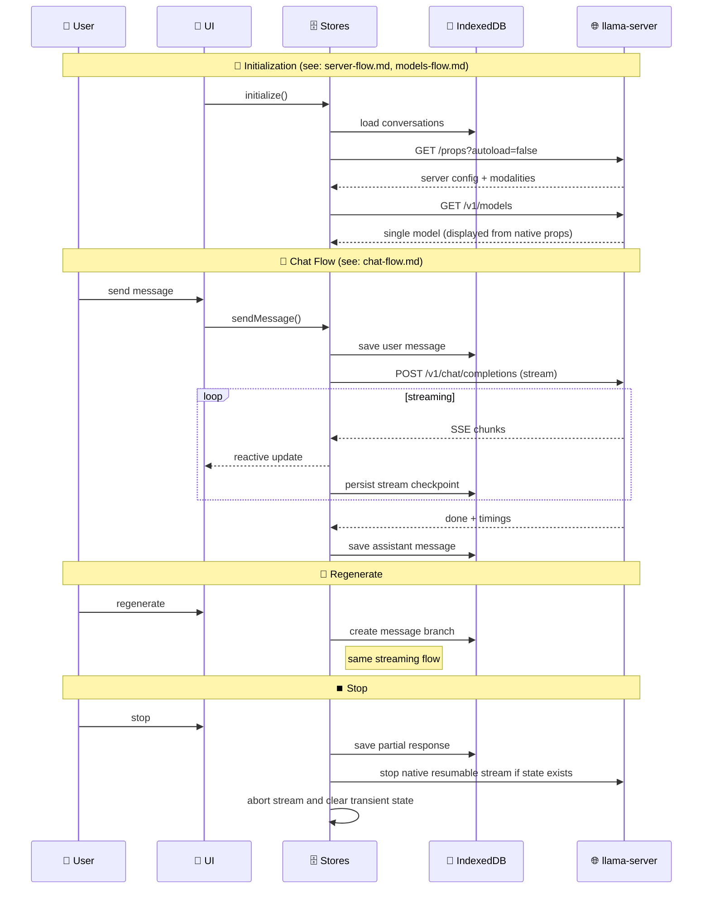

# Native llama-server MODEL mode — simplified data flow

This is the single-model llama.cpp integration, not a universal provider mode.
Services/adapters and the same-origin gateway (Vite development or installed Caddy)
are omitted for readability. The backend runs separately.
See the general [chat](chat-flow.md), [models](models-flow.md) and
[server](server-flow.md) flows for all three providers.

