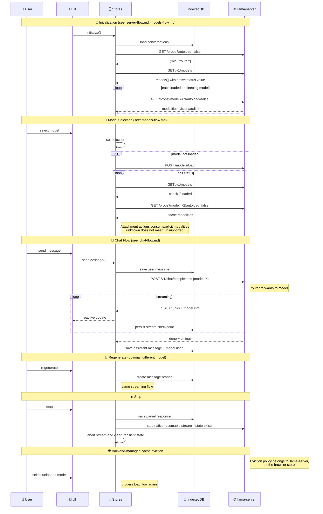

# Native llama-server ROUTER mode — simplified data flow

This is llama.cpp's native multi-model router integration. vLLM and OpenAI-compatible
model selection does not invoke native load/unload or `/props`. Services/adapters
and the same-origin gateway (Vite development or installed Caddy) are omitted here.
See the general [chat](chat-flow.md), [models](models-flow.md) and
[server](server-flow.md) flows for all three providers.

