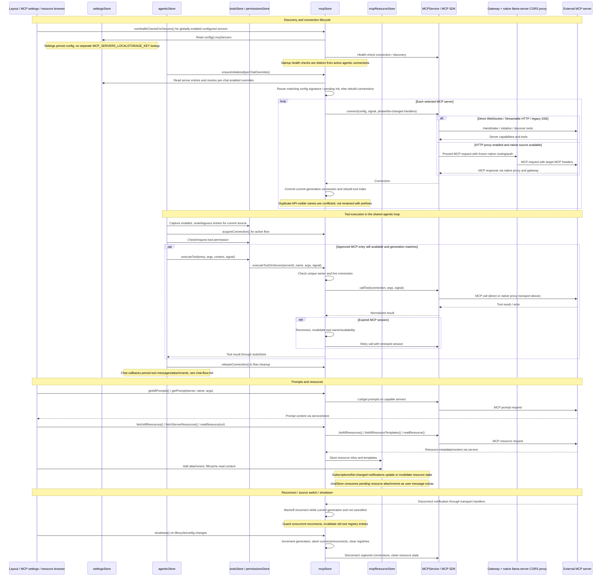

# MCP connections, tools and resources

Direct MCP is independent of the inference provider. The optional HTTP CORS proxy
is a **llama-server-only** feature, reached through the same-origin provider gateway
with the frozen native source context. Native backend authorization and target MCP
authentication headers are separate. WebSocket uses its direct transport.

The proxy is probed only for the native provider (`HEAD /cors-proxy` through its
gateway). Other providers do not inherit that endpoint: configure a browser-reachable
MCP server with the appropriate CORS/authentication for direct HTTP connections.
Legacy SSE endpoint announcements are rewrapped for the configured MCP origin;
native credentials are not sent to another browser origin.

The inference backend receives function definitions/results through its own adapter;
it does not execute the browser's MCP client. Built-in llama-server tools use
`ToolsService` and `/tools`, not an MCP transport. Name conflicts, disabled entries
and stale source/registry generations are rejected before execution.

See [chat-flow.md](chat-flow.md), [conversations-flow.md](conversations-flow.md) and
the [architecture](../architecture/high-level-architecture.md).
