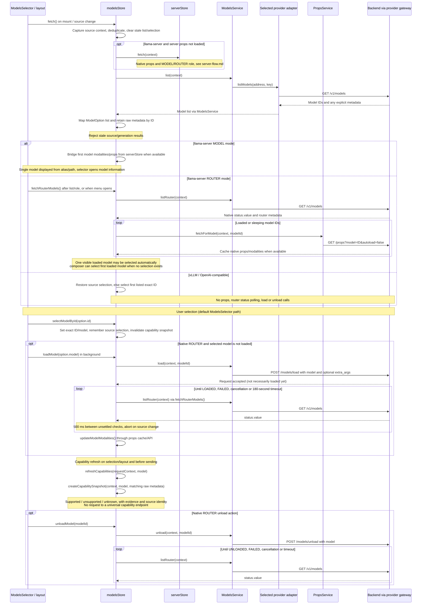

# Models, selection and capabilities

All providers discover models through their adapter's `listModels()` using
`GET /v1/models`. The result is not a promise of identical metadata or model
management APIs. HTTP requests below pass through the same-origin provider gateway;
the diagram abbreviates that transport. See [server-flow.md](server-flow.md).

## Selection is not universal model loading

`usesSelectableModelList` is true for native ROUTER mode and providers requiring
`model` in the chat request (vLLM and OpenAI-compatible). Native MODEL mode displays
the single server model. Compatible adapters require the exact discovered ID, not
a guessed alias or a llama.cpp model path. Selection is remembered in memory per
source (provider/address/credential hash/protocol); favorites are stored per provider.

`ModelsSelector` supports an optional `onModelChange` callback. Its default path
selects first, then initiates native router loading if needed. There is no current
`useModelChangeValidation` hook or automatic “load, validate whole conversation,
unload on modality mismatch” selection workflow. Attachment controls consult current
model capability/modalities; `ChatService` also removes historical image parts only
when native modality information explicitly says `vision === false`.
Compatible protocol builders reject explicitly unsupported media input rather than
silently assuming that all historical attachments can be serialized.

Native `isModelLoaded` treats `LOADED` and `SLEEPING` as loaded; polling after a load
waits specifically for `LOADED`. Model props use a source-scoped TTL cache and
deduplicated requests; router props are fetched only for loaded/sleeping models,
with `autoload=false`. These mechanisms do not apply to compatible providers.

## Runtime capability evidence and protocol selection

Static adapter capabilities describe implemented integration, not proof that a
particular runtime/model supports every feature. `createCapabilitySnapshot()` starts
model-dependent features at **unknown**, applies explicit model-list capability
declarations (including constraints), and tracks source generation, identity and model.
`refreshCapabilities()` reads the matching cached model metadata; it does not probe
generation or fetch an assumed `/props` on compatible backends.

- llama-server uses Chat Completions and its separate native props/modalities path.
- vLLM/OpenAI-compatible prefer Chat Completions when declared and default to it
  when evidence is absent. Responses is chosen only for a responses-only protocol
  list, `required_protocol: "responses"`, or explicit Chat denial plus Responses support.
  An explicit positive Chat declaration takes precedence. No manual protocol selector,
  generation probes, automatic protocol retries or fallback after errors are used.
- Missing modality evidence is not a negative declaration. Unknown images/audio
  remain available only where input serialization exists: compatible Chat supports
  current image/audio formats, Responses supports images but not current input audio,
  and native video representation remains llama-server-only.
- Stock vLLM model lists do not prove runtime modalities from architecture or names.
  Explicit `language_model_only: true` metadata overrides positive modality declarations.
  No `/server_info` endpoint or multimodal generation probe is used.
- Optional model context fields such as `max_model_len`/`context_length` may be
  displayed for compatible providers; GGUF details, chat template and native props
  are not assumed to exist for them.

See [chat-flow.md](chat-flow.md) for payload/stream handling and the native-only
[MODEL](data-flow-simplified-model-mode.md) / [ROUTER](data-flow-simplified-router-mode.md)
summaries.
