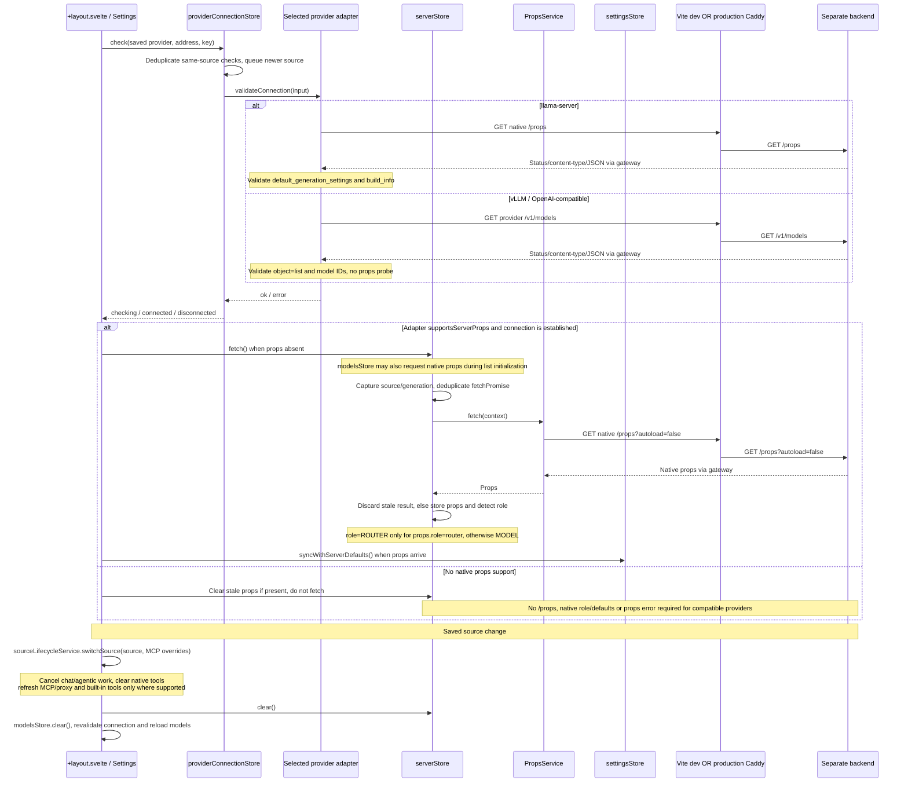

# Provider connection and native server properties

Connection status is owned by `providerConnectionStore`, not inferred from the
presence of llama.cpp props. `serverStore` is a separate **native llama-server**
props/defaults/role store. All HTTP calls below use the same-origin provider gateway.

## Native props consumers

`PropsService.fetch()` and `fetchForModel()` default to `autoload=false`; per-model
requests add `model=ID`. Global props in MODEL mode describe the single model;
ROUTER mode needs per-model props for model-specific information. Neither endpoint
is part of the vLLM/OpenAI-compatible discovery path.

`serverStore` exposes:

- `defaultParams`: `default_generation_settings.params`, or `null`.
- `contextSize`: numeric `default_generation_settings.n_ctx`, or `null`.
- `webuiSettings`: `ui_settings` with `webui_settings` as fallback.
- `isRouterMode` / `isModelMode`, derived from the native role.
- `hasCurrentProps`, checking provider/address/key ownership.

Native props feed model information/modalities, settings default synchronization
(through `ParameterSyncService`), chat-template reasoning controls and context size.
They are not a shared backend contract. Compatible models use explicit model-list
metadata and tri-state capability snapshots instead; absent fields remain unknown.

Concurrent native props calls share `fetchPromise`. Fetch completion checks source
and request generation; `clear()` invalidates pending results and resets props,
error, loading and role. A fetch failure is translated into a localized native props
error; provider-neutral connection failures are reported separately by the connection
store. A failed inference connection does not prevent the static UI from loading.

## Gateway scope

The browser calls `/__llampart/api/{provider}/{endpoint}` with transport-owned routing
headers. Development uses streaming middleware in Vite's existing process; installed
production uses Caddy. There is no automatic inference startup, separate dev gateway
daemon or API gateway in `vite preview`. The gateway validates/strips routing metadata,
forwards Authorization and SSE, and closes upstream requests on browser cancellation.
It has no generation retry or universal capability-detection endpoint.

See [models](models-flow.md), [chat](chat-flow.md), [frontend development](../../README.md)
and [Caddy deployment/security](../../../../docs/installation/linux-caddy.md).
