# Settings flow

## Persistence and validation

- `LlamaCppWebui.config` (`CONFIG_LOCALSTORAGE_KEY`) holds the flat settings object,
  serialized with `__llampartSettingsVersion: 1`. This storage marker is separate
  from the settings export's `formatVersion` (also currently `1`).
- `LlamaCppWebui.userOverrides` (`USER_OVERRIDES_LOCALSTORAGE_KEY`) holds an array
  of user-overridden, server-syncable keys. Parsing removes unknown keys and duplicates.
- `parseSettingsStorage()` validates stored values, fills missing local settings
  from `SETTING_CONFIG_DEFAULT`, and normalizes font families and variants.
  `validateSettingsPatch()` rejects invalid recognized values before an update is saved.
- The store keeps provider-specific connection profiles and exposes the active
  profile through `serverBaseUrl` and `apiKey` on initialization/provider changes.
- Custom wallpaper image data lives separately at
  `llampart:frosted-glass:user-wallpaper`, not inside the settings object.
- Separate MCP/Tools keys include `LlamaCppWebui.mcpDefaultEnabled`,
  `LlamaCppWebui.disabledTools`, `LlamaCppWebui.disabledToolKeys`, and
  `LlamaCppWebui.alwaysAllowedTools`. Settings file import/export does not touch them.

## Settings file export and partial import

`ChatSettingsImportExportTab.svelte` uses `settings-import-export.ts`. The existing
JSON envelope remains `{ type: "llampart-settings-export", formatVersion: 1,
app: "llampart", exportedAt, settings, userOverrides }`. The download name remains
`llampart-settings-YYYY-MM-DD.json`.

Export reads **committed localStorage settings**, not unsaved form/appearance
previews. Exportable keys are derived from `SETTING_CONFIG_DEFAULT`, minus the
existing exclusions:

- Shared `serverBaseUrl` / `apiKey` and all connection profiles:
  `llamaServerBaseUrl` / `llamaServerApiKey`, `vllmBaseUrl` / `vllmApiKey`,
  `openAiCompatibleBaseUrl` / `openAiCompatibleApiKey`.
- Retired `openAiCompatibleProtocol` and `vllmProtocol` fields.
- Internal `titleGenerationPrompt`.
- MCP/Tools settings: `mcpServers`, `mcpServerUsageStats`, `agenticMaxTurns`,
  `agenticMaxToolPreviewLines`, `showToolCallInProgress`, `alwaysShowAgenticTurns`.

`apiProvider` **remains exportable/importable**, with the existing allowed values
`llama-server`, `vllm`, and `openai-compatible`. Selecting a provider in an imported
file does not import its address or secret; initialization uses that provider's
existing local connection profile.

Import accepts valid V1 files, filters out unrecognized/excluded keys, validates
all remaining supplied values, then merges the patch over the current local
configuration. Missing keys retain their **current values**, not defaults from the
file. Invalid recognized values abort validation before either settings or
`userOverrides` is written. Existing error messages/handling remain unchanged.

Exported `userOverrides` contains only parsed, exportable override keys. Import
retains existing non-exportable overrides and replaces the exportable override
portion with the filtered imported list (or an empty list if absent), deduplicated.
Partial-import preservation of setting values does not change this override rule.

### Newer settings and older-file notification

These settings already participate in the same flat export/partial-import path:

| Group                      | Keys                                                                                                                                                                                                                      | Existing validation                                                          |
| -------------------------- | ------------------------------------------------------------------------------------------------------------------------------------------------------------------------------------------------------------------------- | ---------------------------------------------------------------------------- |
| Response preferences       | `responsePrefNoHeadings`, `responsePrefTables`, `responsePrefCharts`, `responsePrefDiagrams`, `responsePrefNoDecorations`, `responsePrefConcise`, `responsePrefExamples`, `responsePrefSteps`, `responsePrefUserLanguage` | Strict booleans                                                              |
| Interface scale            | `uiScale`                                                                                                                                                                                                                 | String enum: `90`, `95`, `100`, `105`, `110`                                 |
| Typography                 | `fontFamily`, `fontVariant`, `fontSize`                                                                                                                                                                                   | Existing supported-family/variant normalization; size `default` or `12`–`20` |
| Frosted Glass transparency | `frostedGlassMilkiness`, `frostedGlassOpaque` (UI: “Disable transparency”)                                                                                                                                                | Integer 0–100; strict boolean                                                |

`frostedGlassWallpaper` still exports only the selected wallpaper ID, including
the custom-wallpaper ID. Neither bundled image bytes nor custom image data is
embedded in the JSON. A custom wallpaper must already be available locally for
that selection to display; the existing wallpaper fallback is unchanged.

After validating the envelope, import checks own-key presence in the original
`settings` object **before normalization or merging**. The import result lists a
group if any of its listed new fields is missing. An old file without these
groups lists all four; a partial file lists only incomplete groups; a complete
current file lists none. `false`, `0`, empty strings and defaults are not missing
keys (supplied values still undergo their existing validation). Detection does
not infer age from `formatVersion` and does not reject otherwise valid older files.

After successful import, the existing success toast and reload confirmation
dialog remain. For an incomplete/older file, the **same dialog** additionally
names only the incomplete groups, explains that absent settings were not changed,
and recommends exporting a fresh backup. Warning text and group labels are
translated into EN, PL, DE, FR, IT and ES. A complete file retains the original
dialog text. Confirm reloads the app; Cancel only closes the dialog and **does not
undo the completed import**.

The Settings form's existing Save, Cancel and Reset behavior is unchanged:
appearance preview is separate from committed settings, Save validates/commits,
and Cancel discards the draft. Settings import does not access conversation
history, IndexedDB, or the independent conversation import/export format.

## Store lifecycle

```mermaid
sequenceDiagram
    participant UI as 🧩 ChatSettings
    participant settingsStore as 🗄️ settingsStore
    participant serverStore as 🗄️ serverStore
    participant ParamSvc as ⚙️ ParameterSyncService
    participant LS as 💾 LocalStorage

    Note over settingsStore: State:<br/>config: SettingsConfigType (includes theme ID)<br/>isInitialized: boolean<br/>userOverrides: Set of strings

    %% ═══════════════════════════════════════════════════════════════════════════
    Note over UI,LS: 🚀 INITIALIZATION
    %% ═══════════════════════════════════════════════════════════════════════════

    Note over settingsStore: Auto-initialized in constructor (browser only)
    settingsStore->>settingsStore: initialize()
    activate settingsStore

    settingsStore->>settingsStore: loadConfig()
    settingsStore->>LS: get("LlamaCppWebui.config")
    LS-->>settingsStore: StoredConfig | null

    alt config exists
        settingsStore->>settingsStore: parseSettingsStorage(), normalize provider profile
        Note right of settingsStore: Fill missing keys with defaults
    else no config
        settingsStore->>settingsStore: config = SETTING_CONFIG_DEFAULT
    end

    settingsStore->>LS: get("LlamaCppWebui.userOverrides")
    LS-->>settingsStore: string[] | null
    settingsStore->>settingsStore: parseUserOverrides(), populate userOverrides

    settingsStore->>settingsStore: isInitialized = true
    deactivate settingsStore

    %% ═══════════════════════════════════════════════════════════════════════════
    Note over UI,LS: 🔄 SYNC WITH SERVER DEFAULTS
    %% ═══════════════════════════════════════════════════════════════════════════

    Note over UI: Triggered from +layout.svelte when serverStore.props loaded
    UI->>settingsStore: syncWithServerDefaults()
    activate settingsStore

    settingsStore->>serverStore: defaultParams
    serverStore-->>settingsStore: {temperature, top_p, top_k, ...}

    loop each SYNCABLE_PARAMETER
        alt key NOT in userOverrides
            settingsStore->>settingsStore: config[key] = serverDefault[key]
            Note right of settingsStore: Non-overridden params adopt server default
        else key in userOverrides
            Note right of settingsStore: Keep user value, skip server default
        end
    end

    alt serverStore.props has webuiSettings
        settingsStore->>settingsStore: Apply webuiSettings from server
        Note right of settingsStore: Validated UI settings for non-overridden keys<br/>Response preferences remain user-owned
    end

    settingsStore->>settingsStore: saveConfig()
    deactivate settingsStore

    %% ═══════════════════════════════════════════════════════════════════════════
    Note over UI,LS: ⚙️ UPDATE CONFIG
    %% ═══════════════════════════════════════════════════════════════════════════

    UI->>settingsStore: updateConfig(key, value)
    activate settingsStore
    settingsStore->>settingsStore: config[key] = value

    alt syncable key with a matching server default
        settingsStore->>settingsStore: userOverrides.delete(key)
        Note right of settingsStore: Matches server default, remove override
    else syncable key with a different server default
        settingsStore->>settingsStore: userOverrides.add(key)
        Note right of settingsStore: Mark as user-modified (won't be overwritten)
    end

    settingsStore->>settingsStore: saveConfig()
    settingsStore->>LS: set(CONFIG_LOCALSTORAGE_KEY, config)
    settingsStore->>LS: set(USER_OVERRIDES_LOCALSTORAGE_KEY, [...userOverrides])
    deactivate settingsStore

    UI->>settingsStore: updateMultipleConfig({key1: val1, key2: val2})
    activate settingsStore
    Note right of settingsStore: Batch update, single save
    settingsStore->>settingsStore: For each key: config[key] = value
    settingsStore->>settingsStore: Update overrides for syncable keys with server defaults
    settingsStore->>settingsStore: saveConfig()
    deactivate settingsStore

    %% ═══════════════════════════════════════════════════════════════════════════
    Note over UI,LS: 🔄 RESET
    %% ═══════════════════════════════════════════════════════════════════════════

    UI->>settingsStore: resetConfig()
    activate settingsStore
    settingsStore->>settingsStore: config = {...SETTING_CONFIG_DEFAULT}
    Note right of settingsStore: Cancel preview, validate defaults<br/>resetConfig() keeps the existing override set
    settingsStore->>settingsStore: saveConfig()
    deactivate settingsStore

    UI->>settingsStore: resetParameterToServerDefault(key)
    activate settingsStore
    settingsStore->>settingsStore: userOverrides.delete(key)
    settingsStore->>serverStore: defaultParams[key]
    settingsStore->>settingsStore: config[key] = serverDefault
    settingsStore->>settingsStore: saveConfig()
    deactivate settingsStore

    %% ═══════════════════════════════════════════════════════════════════════════
    Note over UI,LS: 🎨 THEME
    %% ═══════════════════════════════════════════════════════════════════════════

    UI->>settingsStore: updateConfig("theme", newTheme)
    activate settingsStore
    settingsStore->>settingsStore: normalize theme through the theme registry
    settingsStore->>settingsStore: saveConfig()
    settingsStore->>LS: set(CONFIG_LOCALSTORAGE_KEY, config)
    deactivate settingsStore

    %% ═══════════════════════════════════════════════════════════════════════════
    Note over UI,LS: 📊 PARAMETER INFO
    %% ═══════════════════════════════════════════════════════════════════════════

    UI->>settingsStore: getParameterInfo(key)
    settingsStore->>ParamSvc: getParameterInfo(key, config, serverDefaults, userOverrides)
    ParamSvc-->>settingsStore: ParameterInfo
    Note right of ParamSvc: {<br/>  currentValue,<br/>  serverDefault,<br/>  isUserOverride: boolean,<br/>  canSync: boolean,<br/>  isDifferentFromServer: boolean<br/>}

    UI->>settingsStore: getParameterDiff()
    settingsStore->>ParamSvc: createParameterDiff(config, serverDefaults, userOverrides)
    ParamSvc-->>settingsStore: ParameterDiff[]
    Note right of ParamSvc: Array of parameters where user != server

    %% ═══════════════════════════════════════════════════════════════════════════
    Note over UI,LS: 📋 CONFIG CATEGORIES
    %% ═══════════════════════════════════════════════════════════════════════════

    Note over settingsStore: Syncable with server (from /props):
    rect rgb(240, 255, 240)
        Note over settingsStore: temperature, top_p, top_k, min_p<br/>repeat_penalty, presence_penalty, frequency_penalty<br/>dynatemp_range, dynatemp_exponent<br/>typ_p, xtc_probability, xtc_threshold<br/>dry_multiplier, dry_base, dry_allowed_length, dry_penalty_last_n
    end

    Note over settingsStore: UI-only (not synced):
    rect rgb(255, 240, 240)
        Note over settingsStore: responsePref* (nine booleans), uiScale<br/>fontFamily, fontVariant, fontSize<br/>frostedGlassWallpaper, frostedGlassMilkiness, frostedGlassOpaque<br/>apiProvider and provider connection profiles
    end
```

