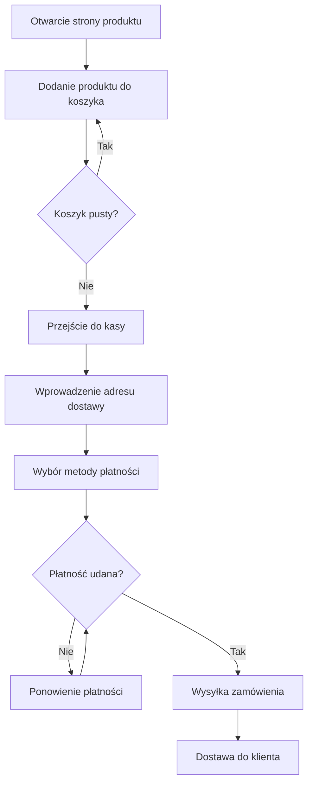
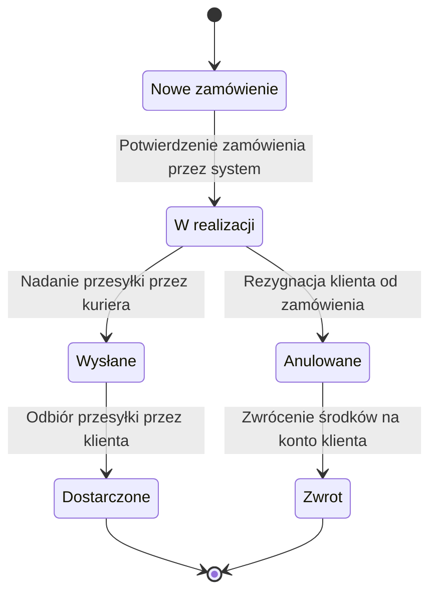
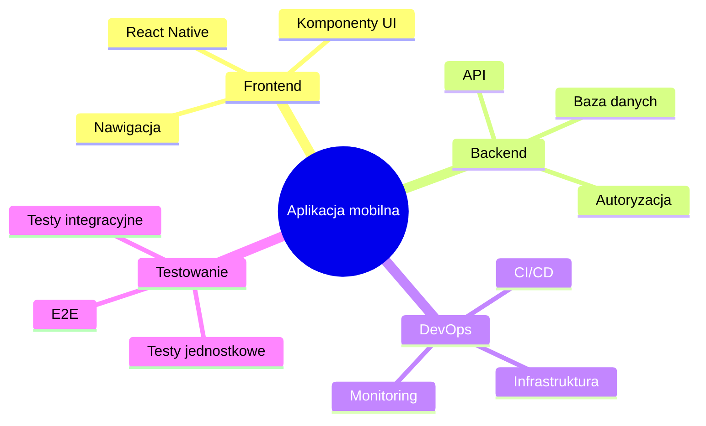
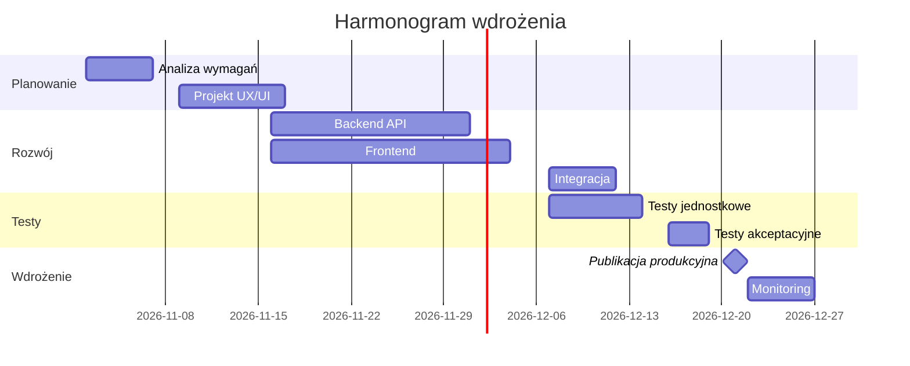

**1. Flowchart — Proces zamawiania produktu**



**2. State Diagram — Cykl życia zamówienia**



**3. Mindmap — Architektura aplikacji mobilnej**



**4. Gantt — Harmonogram wdrożenia aplikacji**



**5. Line — Przychody i koszty w 2026 roku**

```llampart-chart
{"type":"line","title":"Przychody i koszty w 2026 roku","description":"Wartości w tysiącach złotych","xKey":"miesiac","xLabel":"Miesiąc","yLabel":"Tys. zł","series":[{"key":"przychody","label":"Przychody"},{"key":"koszty","label":"Koszty"}],"data":[{"miesiac":"Sty","przychody":42,"koszty":28},{"miesiac":"Lut","przychody":58,"koszty":33},{"miesiac":"Mar","przychody":49,"koszty":31},{"miesiac":"Kwi","przychody":73,"koszty":41},{"miesiac":"Maj","przychody":65,"koszty":39},{"miesiac":"Cze","przychody":92,"koszty":52},{"miesiac":"Lip","przychody":81,"koszty":48},{"miesiac":"Sie","przychody":105,"koszty":61},{"miesiac":"Wrz","przychody":91,"koszty":54},{"miesiac":"Paź","przychody":118,"koszty":69},{"miesiac":"Lis","przychody":110,"koszty":64},{"miesiac":"Gru","przychody":136,"koszty":78}]}
```

**6. Area — Skumulowane pobrania aplikacji**

```llampart-chart
{"type":"area","title":"Skumulowane pobrania aplikacji","description":"Wartości w tysiącach pobrań","xKey":"miesiac","xLabel":"Miesiąc","yLabel":"Tys. pobrań","series":[{"key":"pobrania","label":"Pobrania"}],"data":[{"miesiac":"Sty","pobrania":120},{"miesiac":"Lut","pobrania":310},{"miesiac":"Mar","pobrania":650},{"miesiac":"Kwi","pobrania":1050},{"miesiac":"Maj","pobrania":1580},{"miesiac":"Cze","pobrania":2210},{"miesiac":"Lip","pobrania":2950},{"miesiac":"Sie","pobrania":3810},{"miesiac":"Wrz","pobrania":4780},{"miesiac":"Paź","pobrania":5860},{"miesiac":"Lis","pobrania":7130},{"miesiac":"Gru","pobrania":8640}]}
```

**7. Bar — Wyniki sprzedaży produktów**

```llampart-chart
{"type":"bar","title":"Wyniki sprzedaży produktów","description":"Wartości w tysiącach sztuk","xKey":"produkt","xLabel":"Produkt","yLabel":"Tys. szt.","series":[{"key":"q1","label":"Q1"},{"key":"q2","label":"Q2"}],"data":[{"produkt":"Laptop","q1":85,"q2":110},{"produkt":"Monitor","q1":120,"q2":155},{"produkt":"Klawiatura","q1":175,"q2":190},{"produkt":"Mysz","q1":145,"q2":170},{"produkt":"Słuchawki","q1":105,"q2":145}]}
```

**8. Donut — Udział kanałów sprzedaży**

```llampart-chart
{"type":"donut","title":"Udział kanałów sprzedaży","description":"Udział procentowy kanałów sprzedaży","labelKey":"kategoria","valueKey":"udzial","data":[{"kategoria":"Sklep internetowy","udzial":34},{"kategoria":"Marketplace","udzial":24},{"kategoria":"Sprzedaż bezpośrednia","udzial":18},{"kategoria":"Partnerzy","udzial":12},{"kategoria":"Aplikacja mobilna","udzial":8},{"kategoria":"Pozostałe","udzial":4}]}
```
